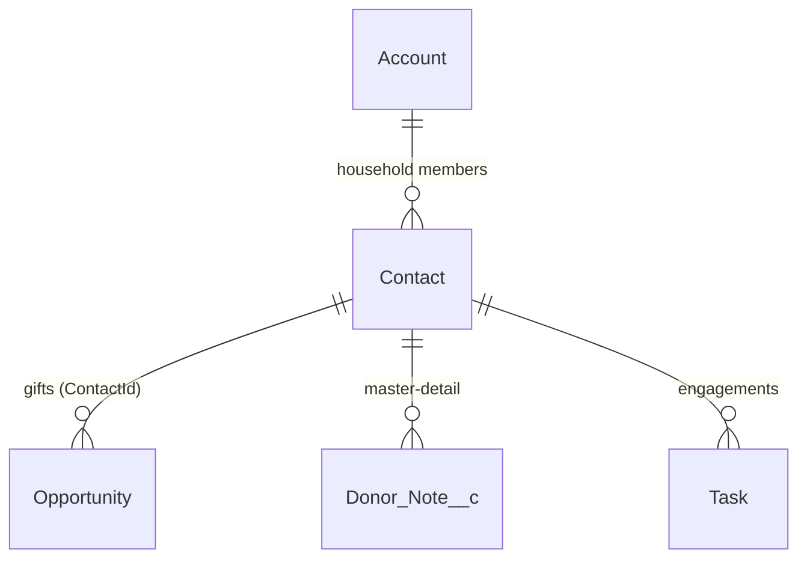

# Fundraiser Briefing Agent

> An Agentforce agent that prepares a major-gifts officer for a donor meeting in seconds.
> Built for **Lakeside Community Trust**, a fictional Swiss nonprofit. All donors, gifts and notes are synthetic.
> Amounts are in the org currency (USD in the demo org).

**Status:** 🚧 Phase 4 of 5 (data model, scoring service, demo data, engagements flow, Data 360 retriever guide). Sections marked _TODO_ are filled in as each phase lands.

---

## 1. The business problem

Major-gifts officers typically spend 20–40 minutes before each donor meeting clicking through
gift history, activity timelines and scattered meeting notes to answer five questions:

1. How has this person given to us, and is it going up or down?
2. When did we last speak, and what did we promise to follow up on?
3. Are we at risk of losing them?
4. What should I ask for?
5. What did they tell us last time that I must not forget?

This project lets the officer type **"Prep me for my meeting with Eleanor Hart"** and get a
short, consistent briefing that answers all five. The numbers are computed in code, not guessed by the LLM.

## 2. What the briefing contains

| Section | Source | Computed by |
| --- | --- | --- |
| Giving history (total, last gift, frequency, trend) | Closed Won Opportunities | Apex `DonorBriefingService` |
| Last engagement & open tasks | Task | Flow `Get_Donor_Engagements` |
| Lapse-risk score + one-line explanation | Gift history (RFM) | Apex `DonorBriefingService` |
| Suggested ask amount + reasoning | Gift history + capacity rating | Apex `DonorBriefingService` |
| Relevant context from notes | `Donor_Note__c` → Data 360 search index | Agentforce retriever |

## 3. Architecture

_TODO (Phase 2+): finalise once components exist._

```mermaid
flowchart LR
    U[Gift officer<br/>Agentforce panel] --> A[Agentforce agent<br/>Topic: Donor Meeting Prep]
    A -->|Apex action| S[DonorBriefingService<br/>@InvocableMethod]
    A -->|Flow action| F[Get_Donor_Engagements<br/>Autolaunched Flow]
    A -->|Retriever| R[Data 360 Retriever]
    S --> O[(Contact / Account<br/>Opportunity)]
    F --> T[(Task)]
    R --> I[Search Index<br/>chunked + vectorised]
    I --> D[(Donor_Note__c<br/>via CRM data stream)]
    G[Python data generator] -. CSV import .-> O
    G -. CSV import .-> D
```

## 4. Data model

Standard objects in the NPSP-style "household" pattern, plus one custom object.
See [Design decisions](#7-design-decisions--trade-offs) for why this was chosen over Nonprofit Cloud.



| Object | Role | Custom fields |
| --- | --- | --- |
| `Account` | Household | none |
| `Contact` | Donor | `Capacity_Rating__c` (A–D wealth band), `Preferred_Name__c` |
| `Opportunity` | Gift: **Closed Won + primary Contact = received gift** | `Gift_Type__c` (One-off / Recurring / Grant / Pledge Payment) |
| `Task` / `Event` | Engagements | none |
| `Donor_Note__c` | Meeting/call notes, grant reports (indexed by Data 360) | `Contact__c` (M-D), `Note_Type__c`, `Note_Date__c`, `Body__c` (long text) |

### Scoring rules (`DonorBriefingService`)

The service only fetches data. The logic lives in small pure classes (`GivingSummary`, `LapseRiskScorer`,
`AskAmountCalculator`) that take a list of gifts and an *as-of date*, so every rule is unit-tested without DML.

**Lapse risk (0–100, higher = riskier)**: Low < 30 ≤ Medium < 60 ≤ High

| Factor | Max | Rule |
| --- | --- | --- |
| Recency | 50 | Days since last gift **÷ the donor's own typical gap** (last 7 gifts): ≤1.25× → 0, ≤1.5× → 15, ≤2× → 30, ≤3× → 40, more → 50. Single-gift donors use absolute time. Over 2 years is always 50. |
| Frequency | 25 | **Giving consistency**: of the last three 12-month windows *since the donor's first gift*, how many contain a gift. None missed → 0, 1 missed → 10, 2 missed → 18, no gifts in 3 years → 25. |
| Monetary | 25 | Last 12 vs prior 12 months: Increasing → 0, Stable/New → 5, Declining → 15 (more than 50% drop → 25), Inactive → 25 |

Medium/High explanations name the two biggest risk factors. Low explanations lead with what's going well and add a
`watch:` note only for a factor worth 10 points or more.

**Suggested ask**: the first matching strategy wins.

| # | When | Ask |
| --- | --- | --- |
| 1 | No gifts | No amount: "open with a discovery conversation" |
| 2 | Lapsed more than 2 years | Reactivation at **50% of last gift** |
| 3 | Latest gift is recurring | **Monthly** ask: current monthly gift × risk multiplier |
| 4 | Giving declining | Renew at **last 12 months' level**, with no upgrade |
| 5 | Otherwise | Largest gift in last 3 years × risk multiplier |

Risk multiplier: 1.5 Low (upgrade) / 1.2 Medium / 1.0 High (renewal), +0.1 if giving is increasing. Asks are capped by
capacity rating on an annual basis (B ≤ 100,000, C ≤ 25,000, D ≤ 5,000 a year; monthly asks × 12) and rounded to a
natural figure (finer steps for monthly amounts).

**Calibrated against realistic data.** The first version passed every unit test, but on the generated donors it asked a
declining donor for 2.7× their latest gift, penalised loyal annual donors for "only 3 gifts in 3 years", and gave
monthly donors one-off asks of 50. Unit tests prove the rules are implemented as written; only realistic data
shows whether the rules themselves are any good.

## 5. Repository layout

```text
force-app/main/default/
  classes/          Apex: DonorBriefingService, scoring logic, TestDataFactory, tests
  flows/            Autolaunched flow for open tasks / engagements
  objects/          Custom fields + Donor_Note__c
  permissionsets/   Least-privilege access for the gift-officer persona
  genAiPlugins/     Agentforce topic (added in a later phase)
  genAiFunctions/   Agent action definitions (added in a later phase)
data-generator/     Python script that produces fake CSVs for import
docs/               Data 360 retriever setup, screenshots, ADRs
config/             Scratch-org definition
scripts/apex/       Anonymous Apex helpers (e.g. demo data seeding)
```

## 6. Setup

_TODO: verified, copy-pasteable steps._

Prerequisites: Salesforce CLI (`sf`) v2, a Developer Edition org with Agentforce and Data 360
enabled, and Python 3.10 or later.

1. Clone the repo and authenticate: `sf org login web -a lakeside-dev`
2. Deploy metadata: `sf project deploy start -o lakeside-dev`
3. Assign permission sets. Gift officers get `Lakeside_Gift_Officer`; whoever loads data also gets `Lakeside_Data_Admin`:
   `sf org assign permset -n Lakeside_Gift_Officer -n Lakeside_Data_Admin -o lakeside-dev`
4. Generate and import demo data (about 430 records, around 0.8 MB of the 5 MB Developer Edition allowance):
   ```bash
   python3 data-generator/generate_data.py          # writes CSVs to data-generator/output/
   scripts/import-demo-data.sh lakeside-dev         # Bulk API upserts, safe to re-run
   ```
   Remove it again with `sf apex run -o lakeside-dev -f scripts/apex/delete-demo-data.apex`.
5. Configure the Data 360 retriever (manual Setup steps, about 20 minutes): see [`docs/data-360-retriever-setup.md`](docs/data-360-retriever-setup.md)
6. Activate the agent and try: _"Prep me for my meeting with …"_

### Engagements flow (`Get_Donor_Engagements`)

An autolaunched flow takes `contactId` and returns `openTasksSummary` (one line per open task, overdue first and
marked `OVERDUE`), `openTaskCount`, `overdueTaskCount`, `lastEngagementSubject` and `lastEngagementDate`
(the most recent completed task).

### Demo data

`data-generator/generate_data.py` (standard library only) builds households, donors, gifts, notes and tasks from
**donor archetypes**: loyal monthly, lapsing monthly, growing annual, steady annual, declining, lapsed, new,
prospect and major grant. That way the data exercises every branch of the scoring. Three hand-written "hero"
donors (Eleanor Hart, Marco Bernasconi, Claire Rochat) have rich notes for the demo script. Output is
reproducible: the same `--seed` and `--as-of` give identical files.

Import uses external IDs (`Lakeside_Id__c`) so it is idempotent. `Opportunity.ContactId` and `Task.WhoId` have no
relationship name the Bulk API can resolve, so `resolve_ids.py` swaps in Contact IDs after Contacts load,
the same "VLOOKUP" step as a Data Loader migration.

## 7. Design decisions & trade-offs

_TODO: expand each into a short ADR-style entry._

- **Standard objects over Nonprofit Cloud:** chosen because the target org has neither NPC nor Person Accounts.
- **Single currency:** no multi-currency. Apex labels amounts with the org currency (`UserInfo.getDefaultCurrency()`) rather than hard-coding a symbol, so the same code reads "USD 12,500" in the demo org and "CHF 12'500" in a Swiss one.
- **Deterministic scoring in Apex, narrative in the LLM:** numbers must be auditable and testable.
- **Compute on read vs stored roll-ups:** totals are calculated per request (2 SOQL queries for any batch size).
  There are no triggers and figures are never stale. At large data volumes (thousands of gifts per donor) you'd
  switch to stored roll-ups or Data 360 calculated insights.
- **Custom `Donor_Note__c` vs ContentNote:** ContentNote bodies live in ContentVersion blobs, which the Data 360 CRM
  connector can't ingest cleanly. A long-text field streams straight into a data lake object and can be chunked and vectorised.
  The note object is master-detail to Contact, so note visibility automatically follows the donor.
- **Rule-based RFM vs ML model:** a gift officer has to trust and explain the score. Transparent rules with
  named thresholds are auditable and testable, and the one-line explanation names the biggest driver.
  The thresholds are constants and could become Custom Metadata if fundraising ops want to tune them.
- **Cadence-aware recency:** a monthly donor silent for 4 months is riskier than an annual donor silent for 10.
  Comparing silence with the donor's own rhythm avoids flagging loyal annual givers.
- **Numbers in Apex, words in the LLM:** the action returns typed fields plus a pre-formatted summary. The agent
  narrates; it never calculates.
- **User mode everywhere:** queries run `WITH USER_MODE` (CRUD + FLS enforced). Integration tests run as a
  *Minimum Access* user who has only `Lakeside_Gift_Officer`, which proves the permission set is sufficient on its own.
- **Standard `ContactId` + an ID-resolution step vs a custom `Donor__c` lookup:** a custom lookup would make CSV
  imports one-step, but it would duplicate the standard primary-contact field (which also creates the Opportunity Contact Role).
  The data model stays standard and the import pipeline carries the extra step.
- **Separate data-admin permission set:** loading data needs edit access to external IDs and capacity ratings, which
  gift officers shouldn't have. Two permission sets keep the officer persona least-privilege.
- **Flow for engagements, Apex for scoring:** fetching and formatting tasks is simple record retrieval that an admin
  might reasonably extend (add Events, filter by owner), so it's declarative. Scoring needs real logic and
  boundary tests, so it's Apex. The flow runs `SystemModeWithSharing`: users only see tasks they can access, and
  no FLS-sensitive fields are returned.
- **Agent-ready outputs:** both actions return typed fields *and* a pre-formatted text block, so the agent can
  quote facts without reformatting dates or recomputing counts.
- **Stable demo data IDs:** `Opportunity.ContactId` can be set on insert but **not on update**, so a re-import that
  moved a gift to a different donor is rejected. The generator keeps every `Lakeside_Id__c` stable for a given seed
  (scripted hero tasks use their own `TH-` prefix and no random numbers). Changing `--seed` means deleting the
  demo data first.
- **Locale-independent formatting:** `CurrencyFormatter` renders amounts the same way for every user locale (with the Swiss apostrophe separator for CHF), so
  test assertions and agent output are stable.

## 8. Testing

```bash
sf apex run test -o lakeside-dev -l RunLocalTests -c -r human -w 10
```

| Layer | Classes | What it proves |
| --- | --- | --- |
| Pure logic | `GivingSummaryTest`, `LapseRiskScorerTest`, `AskAmountCalculatorTest`, `CurrencyFormatterTest` | Every threshold and boundary, using in-memory gifts and a fixed as-of date (no DML, fast) |
| Flow | `GetDonorEngagementsFlowTest` | Runs the flow through `Flow.Interview` exactly as the agent does: overdue ordering, completed vs open, no cross-donor leakage |
| Integration | `DonorBriefingServiceTest` | Query filters (open opportunities excluded), mapping, error responses, bulk safety (100 requests → 2 queries), least-privilege access |

`TestDataFactory` builds households, donors, gift series ("monthly for 2 years") and notes.
Current result: **54 tests, 100% coverage** on all production classes.

## 9. Limitations & next steps

_TODO_

## Licence

MIT. All data is synthetic, and any resemblance to real people or organisations is coincidental.
