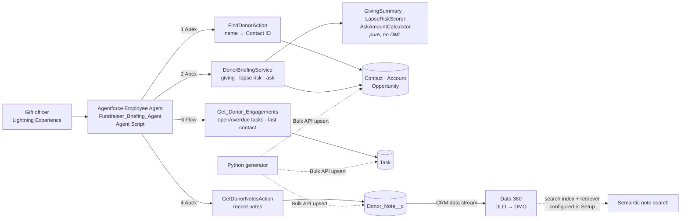
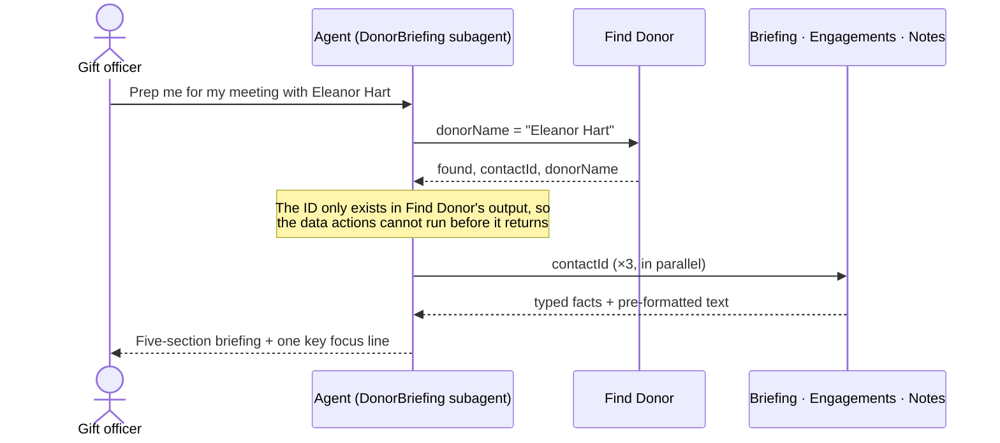
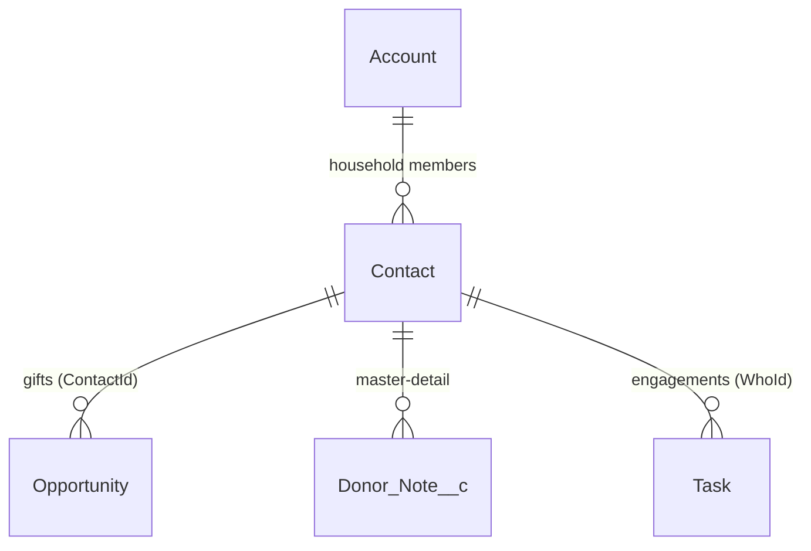

# Fundraiser Briefing Agent

> An Agentforce agent that prepares a major-gifts officer for a donor meeting in seconds.
> Built for **Lakeside Community Trust**, a fictional nonprofit. All donors, gifts and notes are synthetic.

A gift officer types **"Prep me for my meeting with Eleanor Hart"** and gets a short briefing: giving history,
last engagement and open tasks, a lapse-risk score with its reason, a suggested ask with its reasoning, and the
details from past notes they must not forget. **Every number is computed in Apex and tested. The LLM only narrates.**

Condensed from a live run (the full, unedited output is in the transcript linked below):

```text
Briefing: Eleanor Hart

Giving history:   USD 32,500 across 5 gifts since 2022; last gift USD 9,750 on 2026-09-01.
                  1.0 gifts/year, trend: increasing (+30% year on year)
Engagement:       Last engagement: Sent impact report (2026-03-28)
                  Open task, due 28 October 2026: Bring Kriens site costings and named-fund options [High]
Lapse risk:       0/100 (Low). Last gift 7 weeks ago, in line with her usual rhythm (every 12 months);
                  gave in each of the last 3 years; giving up 30% year on year
Suggested ask:    USD 16,000 one-off. 1.6x largest gift in the last 3 years (USD 9,750): upgrade ask for a
                  low-risk donor, with a bonus for increasing giving
Context from notes:
  - 2026-08-14: asked whether a gift could fund a second after-school site in Kriens; wants any named fund to
    honour her late husband, a primary teacher for 30 years; prefers mornings, no phone calls
  - 2026-04-06: reviewing estate plans this autumn; open to a legacy conversation next year (keep it low-key)
Key focus: bring the Kriens costings and named-fund options.
```

Full, unedited agent transcripts: [`docs/demo-transcript.md`](docs/demo-transcript.md).

---

## 1. The business problem

Major-gifts officers typically spend 20–40 minutes before each donor meeting clicking through gift history,
activity timelines and scattered notes to answer five questions:

1. How has this person given to us, and is it going up or down?
2. When did we last speak, and what did we promise to follow up on?
3. Are we at risk of losing them?
4. What should I ask for?
5. What did they tell us last time that I must not forget?

The briefing answers all five, the same way for every donor, in the officer's own words ("Brief me on Marco",
"what did she say about a legacy gift?").

## 2. Architecture



| Briefing section | Source | Built with |
| --- | --- | --- |
| Giving history (total, last gift, frequency, trend) | Closed Won Opportunities | Apex `DonorBriefingService` + `GivingSummary` |
| Lapse-risk score + one-line explanation | Gift history (cadence-aware RFM) | Apex `LapseRiskScorer` |
| Suggested ask + reasoning | Gift history, gift type, capacity rating | Apex `AskAmountCalculator` |
| Last engagement & open tasks | Task | Flow `Get_Donor_Engagements` |
| Context from notes | `Donor_Note__c` | Apex `GetDonorNotesAction` (recent notes, live). Data 360 stream + DMO for semantic search |

### How the agent chains its actions



If the name matches several donors ("Simon"), Find Donor returns the candidates and the agent asks which one.
It never guesses. Follow-ups ("what is her lapse risk?") reuse the current donor, which is held in an agent variable.

## 3. Data model

Standard objects in the NPSP-style household pattern, plus one custom object.



| Object | Role | Custom fields |
| --- | --- | --- |
| `Account` | Household | `Lakeside_Id__c` (external ID) |
| `Contact` | Donor | `Capacity_Rating__c` (A–D band), `Preferred_Name__c`, `Lakeside_Id__c` |
| `Opportunity` | Gift: **Closed Won + primary Contact = received gift** | `Gift_Type__c` (One-off / Recurring / Grant / Pledge Payment), `Lakeside_Id__c` |
| `Task` | Engagement (completed = last contact, open = follow-up) | `Lakeside_Id__c` |
| `Donor_Note__c` | Meeting/call notes, grant reports | `Contact__c` (M-D), `Note_Type__c`, `Note_Date__c`, `Body__c` (long text), `Lakeside_Id__c` |

### Scoring rules

The service only fetches data. The rules live in small pure classes that take a list of gifts and an
*as-of date*, so every threshold is unit-tested without inserting records.

**Lapse risk (0–100, higher = riskier)**: Low < 30 ≤ Medium < 60 ≤ High

| Factor | Max | Rule |
| --- | --- | --- |
| Recency | 50 | Days since last gift **÷ the donor's own typical gap** (last 7 gifts): ≤1.25× → 0, ≤1.5× → 15, ≤2× → 30, ≤3× → 40, more → 50. Single-gift donors use absolute time. Over 2 years is always 50. |
| Frequency | 25 | **Giving consistency**: of the last three 12-month windows *since the donor's first gift*, how many contain a gift. None missed → 0, 1 missed → 10, 2 missed → 18, nothing in 3 years → 25. |
| Monetary | 25 | Last 12 vs prior 12 months: Increasing → 0, Stable/New → 5, Declining → 15 (more than 50% drop → 25), Inactive → 25 |

Medium/High explanations name the two biggest risk factors. Low explanations lead with what's going well, plus
a `monitor:` note for any single factor worth 10 points or more.

**Suggested ask**: the first matching strategy wins.

| # | When | Ask |
| --- | --- | --- |
| 1 | No gifts | No amount: "open with a discovery conversation" |
| 2 | Lapsed more than 2 years | Reactivation at **50% of last gift** |
| 3 | Latest gift is recurring | **Monthly** ask: current monthly gift × risk multiplier |
| 4 | Giving declining | Renew at **last 12 months' level**, with no upgrade |
| 5 | Otherwise | Largest gift in the last 3 years × risk multiplier |

Risk multiplier: 1.5 Low (upgrade) / 1.2 Medium / 1.0 High (renewal), +0.1 if giving is increasing. Asks are capped by
capacity rating per year (B ≤ 100,000, C ≤ 25,000, D ≤ 5,000; monthly asks × 12) and rounded to natural figures.

**Calibrated against realistic data.** The first version passed every unit test, but on generated donors it asked a
declining donor for 2.7× their latest gift, penalised loyal annual donors for "only 3 gifts in 3 years", and gave
monthly donors one-off asks of 50. Unit tests prove the rules are implemented as written; only realistic data shows
whether the rules themselves are any good.

## 4. Repository layout

```text
force-app/main/default/
  aiAuthoringBundles/  The agent, in Agent Script (source of truth; published, not deployed)
  classes/             Apex actions, pure scoring classes, TestDataFactory, tests
  flows/               Get_Donor_Engagements (autolaunched, agent action)
  objects/             Custom fields, Donor_Note__c, Lakeside_Id__c external IDs
  permissionsets/      Lakeside_Gift_Officer (least privilege), Lakeside_Data_Admin (data loading)
data-generator/        generate_data.py (fake data), resolve_ids.py (ID lookup for import)
scripts/               deploy.sh, import-demo-data.sh, setup_data360.py, apex/delete-demo-data.apex
docs/                  Data 360 retriever setup, demo transcripts
```

## 5. Setup

Prerequisites: Salesforce CLI (`sf`) v2 with the agent plugin, a Developer Edition org with **Agentforce and
Data 360** enabled, and Python 3.10 or later. Steps 2–7 were run against the demo org (`agentforce-dev`).

```bash
# 1. Authenticate
sf org login web -a lakeside-dev

# 2. Deploy metadata and run this project's tests (66 tests, 100% coverage)
scripts/deploy.sh lakeside-dev

# 3. Permissions: gift officers get Lakeside_Gift_Officer; the data loader also gets Lakeside_Data_Admin
sf org assign permset -n Lakeside_Gift_Officer -n Lakeside_Data_Admin -o lakeside-dev

# 4. Demo data: about 430 records, around 0.8 MB of the 5 MB Developer Edition allowance; safe to re-run
python3 data-generator/generate_data.py
scripts/import-demo-data.sh lakeside-dev

# 5. Publish and activate the agent
sf agent publish authoring-bundle -n Fundraiser_Briefing_Agent -o lakeside-dev --skip-retrieve
sf agent activate -n Fundraiser_Briefing_Agent -o lakeside-dev

# 6. Talk to it (live actions, real data)
sf agent preview start -n Fundraiser_Briefing_Agent --use-live-actions -o lakeside-dev
sf agent preview send  -n Fundraiser_Briefing_Agent -u "Prep me for my meeting with Eleanor Hart" -o lakeside-dev

# 7. Optional: Data 360 for semantic note search (stream, DMO, mapping by API; index + retriever in Setup)
python3 scripts/setup_data360.py lakeside-dev
```

Then follow steps 3–5 of [`docs/data-360-retriever-setup.md`](docs/data-360-retriever-setup.md).
Remove the demo data with `sf apex run -o lakeside-dev -f scripts/apex/delete-demo-data.apex`.

### Demo data

`generate_data.py` (standard library only) builds donors from **archetypes** (loyal monthly, lapsing monthly,
growing annual, steady annual, declining, lapsed, new, prospect, major grant), so the data exercises every scoring
branch. Three hand-written donors (Eleanor Hart, Marco Bernasconi, Claire Rochat) have detailed notes and scripted
follow-ups for the demo. The same `--seed` and `--as-of` always give identical files.

The import upserts on `Lakeside_Id__c`, so it's idempotent. `Opportunity.ContactId` and `Task.WhoId` have no relationship
name the Bulk API can resolve, so `resolve_ids.py` swaps in Contact IDs after Contacts load, the same "VLOOKUP"
step as any Data Loader migration.

## 6. Design decisions & trade-offs

**Data model**
- **Standard objects over Nonprofit Cloud:** the target org has neither NPC nor Person Accounts, and the household
  pattern is what most nonprofit orgs (NPSP) run today. Swapping in `GiftTransaction` later only touches the
  query-to-`DonorGift` mapping in one class.
- **Custom `Donor_Note__c` vs ContentNote:** ContentNote bodies live in ContentVersion blobs that the Data 360 CRM
  connector can't ingest cleanly. A long-text field streams straight into a data lake object. Master-detail to Contact means
  note visibility follows the donor.
- **Standard `ContactId` + an ID-resolution step vs a custom `Donor__c` lookup:** a custom lookup would make imports
  one-step but would duplicate the standard primary-contact field. The model stays standard and the import pipeline carries the extra step.

**Logic**
- **Numbers in Apex, words in the LLM:** actions return typed fields plus pre-formatted text. The agent narrates and never
  calculates, so every figure in a briefing can be traced to a tested rule.
- **Rule-based RFM vs an ML model:** a gift officer has to trust and explain the score. Named thresholds are auditable,
  and the explanation names the biggest driver. The thresholds are constants and could move to Custom Metadata for tuning.
- **Cadence-aware recency:** a monthly donor silent for 4 months is riskier than an annual donor silent for 10.
- **Compute on read vs stored roll-ups:** two SOQL queries for any batch size, no triggers, never stale. At thousands
  of gifts per donor you'd switch to roll-ups or Data 360 calculated insights.
- **Flow for engagements, Apex for scoring:** task retrieval is something an admin might extend (add Events, filter
  by owner), so it's declarative. Scoring needs real logic and boundary tests, so it's Apex.

**Agent**
- **Agent Script in source control:** the whole agent (router, subagents, instructions, action contracts) is one reviewable
  `.agent` file, published with the CLI. The generated `aiAgents/` metadata is ignored.
- **Make action order structural, not a polite request:** the data actions take the Contact ID as an input that only
  Find Donor's output provides, so they can't run before the lookup. (An earlier version read the ID from a variable.
  The model called a Flow in parallel with the lookup, with a blank ID, and Flow returned unrelated tasks. See below.)
- **Recent notes from CRM, semantic search from Data 360:** `GetDonorNotesAction` gives the latest notes in real time
  with record sharing applied. Data 360 adds search across all notes but refreshes on the stream's schedule.

**Security**
- **User mode everywhere:** SOQL runs `WITH USER_MODE`. The Flow runs `SystemModeWithSharing` and returns no
  FLS-sensitive fields.
- **Tested least privilege:** integration tests run as a *Minimum Access* user who holds only `Lakeside_Gift_Officer`,
  which proves the permission set is enough on its own (agent, Apex, Flow, object and field access).
- **Two personas:** loading data needs edit access to external IDs and capacity ratings, which officers shouldn't have.

### Platform gotchas found along the way

Each one was found by running against a real org and is now handled in code or documented:

| Gotcha | Symptom | Fix |
| --- | --- | --- |
| New custom fields grant no FLS, even to admins | `USER_MODE` queries fail with "No such column" | Explicit permission set; tests run as a minimum-access user |
| `Opportunity.ContactId` is insert-only and has no relationship name | Bulk upsert can't resolve it, and re-imports that move a gift fail | ID-resolution step; generator keeps IDs stable per seed |
| `Activity.Field__c` in a permission set | FLS silently dropped on full deploys | Use `Task.Field__c` / `Event.Field__c` |
| Flow filter `WhoId = {!blank}` | Returns every task with no contact (another project's to-dos) | Guard decision + test that plants a contact-less task |
| Flow trims trailing newlines in text templates | Task lines run together | Put the line break *between* `{!summary}` and the new line |
| Email fields reject accented characters | `léa.weber@…` rejected on import | Strip accents for emails only (`unicodedata`) |
| Global `LIMIT` across a batch | One busy donor can crowd out another's notes | Parent-child subquery: `LIMIT` applies per donor |

## 7. Testing

```bash
scripts/deploy.sh lakeside-dev          # deploys and runs every *Test class in the repo
```

| Layer | Classes | What it proves |
| --- | --- | --- |
| Pure logic | `GivingSummaryTest`, `LapseRiskScorerTest`, `AskAmountCalculatorTest`, `CurrencyFormatterTest` | Every threshold and boundary, with in-memory gifts and a fixed as-of date (no DML, fast) |
| Actions | `FindDonorActionTest`, `GetDonorNotesActionTest`, `DonorBriefingServiceTest` | Matching and ambiguity, wildcard escaping, per-donor limits, error responses, bulk safety (one or two queries per batch), least-privilege access |
| Flow | `GetDonorEngagementsFlowTest` | Runs the flow through `Flow.Interview` as the agent does: overdue ordering, no cross-donor leakage, blank-ID guard |
| Agent (live) | `sf agent preview` with `--use-live-actions` | End-to-end conversations against real data: [`docs/demo-transcript.md`](docs/demo-transcript.md) |

`TestDataFactory` builds households, donors, gift series ("monthly for 2 years"), notes and a minimum-access gift officer.
Current result: **66 tests, 100% coverage** on all 8 production classes.

## 8. Limitations & next steps

- **Semantic note search isn't wired into the agent yet.** The Data 360 stream, DMO and mapping are scripted and
  hold all 70 notes. The search index and retriever must be created in Setup (the search index API failed
  server-side with our request), then attached to the agent as an Agentforce Data Library. Recent notes already come
  from CRM in every briefing.
- **Language:** the agent understands German, French and Italian, but answers mostly in English because the actions
  return English text. Proper fix: return translated section text from the actions, or use a translation step before replying.
- **Agent regression tests:** conversations are checked by preview transcripts. Next step: an `AiEvaluationDefinition`
  test suite (`sf agent test`) covering the five-section format, ambiguity and no-hallucination cases.
- **Scoring is rule-based:** good for trust, not tuned on real outcomes. With real data, back-test the thresholds against
  actual lapses and move them to Custom Metadata.
- **Shared demo org:** the demo org also hosts unrelated projects. `scripts/deploy.sh` runs only this project's tests
  for that reason.

## Licence

MIT. All data is synthetic, and any resemblance to real people or organisations is coincidental.
