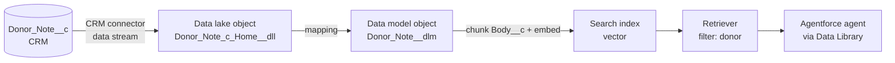

# Data 360 retriever over donor notes

This is the one part of the project that isn't fully deployed from source.

| Step | How | Status in the demo org |
| --- | --- | --- |
| 1. Data stream (CRM → data lake) | **Scripted**: `python3 scripts/setup_data360.py <org>` | ✅ `Donor_Note_c_Home` → `Donor_Note_c_Home__dll`, 70 rows |
| 2. Data model object + mapping | **Scripted** (same command) | ✅ `Donor_Note__dlm`, 70 rows |
| 3. Search index | Setup (manual): the API failed server-side, see below | ⏳ |
| 4. Retriever | Setup (manual) | ⏳ |
| 5. Attach to the agent | CLI (`sf agent adl create`) + one agent action | ⏳ |

Steps 1–2 are idempotent API calls, so re-running the script is safe. The manual steps below are written so they can be
repeated exactly.

**Goal:** when a gift officer asks about a donor, the agent retrieves the most relevant passages from that
donor's `Donor_Note__c` records (meeting notes, call notes, grant reports) and grounds its answer in them.



> Menu labels move between Salesforce releases. If a label below doesn't match your org, search for the
> object name in the Data Cloud app's navigation.

## 0. Prerequisites (check, don't change)

| Check | How | Expected |
| --- | --- | --- |
| Data 360 is provisioned | Data Cloud app opens; a `default` data space exists | ✅ |
| You can build streams and indexes | Your user has **Data Cloud Architect** (or Admin) | assign if missing |
| The CRM connector can read notes | See query below | Read + View All on `Donor_Note__c` and its fields |

The connector reads CRM data as the **Data Cloud Salesforce Connector** permission set
(`sfdc_a360_sfcrm_data_extract`). Salesforce added `Donor_Note__c` to it automatically when the object was
deployed. Verify:

```bash
sf data query -q "SELECT Field FROM FieldPermissions WHERE Parent.Name = 'sfdc_a360_sfcrm_data_extract' AND SobjectType = 'Donor_Note__c'"
```

If `Body__c` is missing, add Read access to the object and its fields in that permission set. Without it, the
stream silently ingests empty note bodies.

## 1–2. Data stream, data model object and mapping (scripted)

```bash
python3 scripts/setup_data360.py agentforce-dev
```

What it does, through the Data 360 Connect API (`/services/data/v65.0/ssot/...`):

1. `POST /data-streams`: a Salesforce CRM stream on `Donor_Note__c`, category **Other** (Engagement would require
   an event date-time field and adds nothing for search), primary key `Id`.
2. `POST /data-model-objects`: a custom DMO `Donor_Note__dlm`. There's no standard "note" DMO that fits, and linking to
   the Individual DMO is only needed if notes should appear in unified profiles or segments.
3. `POST /data-model-object-mappings`: maps each field one-to-one. CRM `Body__c` becomes `Body_c` in the data lake
   and `Body_c__c` in the DMO. `Contact__c` becomes `Contact_c__c`.
4. `POST /data-streams/Donor_Note_c_Home/actions/run`: requests a refresh. The first ingestion took under an hour
   in the demo org. After that, CRM streams refresh on their batch schedule.

Verify:

```bash
echo '{"sql":"SELECT COUNT(*) AS n FROM Donor_Note__dlm"}' > /tmp/q.json
sf api request rest /services/data/v65.0/ssot/query --method POST --body @/tmp/q.json -o agentforce-dev
```

## 3. Create the search index (chunk + embed)

1. **Data Cloud app → Search Index → New → Vector Search → Advanced Setup.**
2. Object: **Donor Note** (`Donor_Note__dlm`).
3. **Chunking:** field `Body_c__c` (the note body), **Passage Extraction**, max 512 tokens.
   The notes are short, so most become a single chunk, and that's fine.
4. **Embedding model:** **Multilingual E5 Large** (`multilingual-e5-large`, available in the demo org). Lakeside's
   donors write in German, French and Italian as well as English.
5. **Fields to include (metadata / prefilters):** `Contact_c__c`, `Note_Type_c__c`, `Note_Date_c__c`, `Name__c`.
   `Contact_c__c` is the important one: it lets the retriever return *only this donor's* notes.

> **Why not the API?** `POST /ssot/search-index` validates the request shape (`developerName`, `sourceDmoDeveloperName`,
> chunk and vector DMO names, `chunkingConfiguration.fieldLevelConfigurations[].sourceDmoFieldName` and `.config.id`,
> `vectorEmbeddingConfiguration.embeddingModel.id`) but then returns `UNKNOWN_EXCEPTION`, with or without data in the
> DMO. Creating the index in the UI and reading it back with `GET /ssot/search-index` would show the missing piece.
> The last request tried:
>
> ```json
> {"developerName": "Donor_Notes_Index", "label": "Donor Notes Index",
>  "sourceDmoDeveloperName": "Donor_Note__dlm",
>  "chunkDmoName": "Donor Notes Index Chunk", "chunkDmoDeveloperName": "Donor_Notes_Index_chunk",
>  "vectorDmoName": "Donor Notes Index Vector", "vectorDmoDeveloperName": "Donor_Notes_Index_vector",
>  "vectorEmbeddingConfiguration": {"embeddingModel": {"id": "multilingual-e5-large"}},
>  "chunkingConfiguration": {"fieldLevelConfigurations": [
>    {"sourceDmoFieldName": "Body_c__c", "config": {"id": "passage_extraction",
>     "userValues": [{"id": "max_tokens", "value": "512"}]}}]}}
> ```
6. Name it `Donor_Notes_Index` → **Save**, then wait until the status is **Ready**.

## 4. Create the retriever

1. **Einstein Studio → Retrievers → New Retriever → Data Cloud.**
2. Data space `default`, object **Donor Note**, index `Donor_Notes_Index`.
3. **Filter:** `Contact_c__c` **equals** a *dynamic* value supplied at runtime (the donor's Contact ID).
   If your release only offers static filters, leave the filter off. The agent then includes the
   donor's name in the search query instead, which works but is less precise (see trade-offs).
4. **Results:** 5 results. Return the chunk text plus `Name`, `Note_Type__c`, `Note_Date__c`.
5. Name it `Donor_Notes_Retriever` → **Save and Activate**.

## 5. Verify

In the retriever's test panel, search for **"legacy gift"**. The top result should be Eleanor Hart's
call note: *"…reviewing her estate plans with her lawyer this autumn and is open to discussing a legacy
gift next year…"*

Other good probes against the demo data:

| Query | Expected donor note |
| --- | --- |
| "card payment failed" | Marco Bernasconi: bounced monthly payment |
| "frustrated, not kept informed" | Claire Rochat: delayed food bank cold-store |
| "named fund husband teacher" | Eleanor Hart: lunch at the boathouse |

## 6. Connect it to the agent

The agent already includes **recent** notes through `GetDonorNotesAction` (CRM, real time). The retriever adds
**semantic** search across all of a donor's notes. Wrap it in an Agentforce Data Library from the CLI:

```bash
sf agent adl create -o agentforce-dev \
  -n "Donor Notes" --developer-name Donor_Notes \
  --source-type retriever --retriever-id <retriever ID from Einstein Studio>
```

Then, in Agent Builder, add the data library to the **Donor Briefing** subagent. Instruct the agent to use it for
open questions ("anything about legacy giving?") and to keep `Get_Donor_Notes` for the briefing itself. Retrieve the
updated authoring bundle (`sf project retrieve start -m AiAuthoringBundle:Fundraiser_Briefing_Agent`) so the change
is in source control.

## Trade-offs

- **Retriever per donor (prefilter) vs global search:** filtering on `Contact__c` guarantees the officer never
  sees another donor's notes in a briefing, and it means fewer, more relevant chunks. Without a dynamic filter,
  search relies on the donor's name appearing in the note text, and our generated notes always use the first name.
- **Data visibility:** Data 360 indexes all notes through the connector's View All access. Sharing is
  enforced *before* retrieval only if the prefilter is applied. That's another reason to treat the `Contact__c`
  filter as a requirement rather than a nice-to-have, and to only call the retriever for a donor the user
  can already open. In Phase 5 the agent calls the Apex briefing action, which checks access in user mode, before it calls the retriever.
- **Freshness:** CRM data streams refresh on a schedule, not in real time. A note typed five minutes before a
  meeting may not be searchable yet. That's why the briefing reads recent notes from CRM directly, and the
  structured parts (Apex + Flow) are always live.
- **Cost:** ingestion, indexing and retrieval consume Data 360 credits. At 70 short notes this is negligible,
  but at production volumes it's a real line item.

## Teardown

Delete in reverse order: retriever → search index → data mapping/DMO → data stream. A data stream can't be
deleted while a search index still depends on its DMO.
