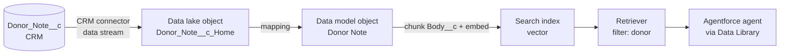

# Data 360 retriever over donor notes

This is the one part of the project that isn't deployed from source. Data streams, search indexes
and retrievers are configured in Setup. This guide makes those manual steps repeatable.

**Goal:** when a gift officer asks about a donor, the agent retrieves the most relevant passages from that
donor's `Donor_Note__c` records (meeting notes, call notes, grant reports) and grounds its answer in them.



> Menu labels move between Salesforce releases. If a label below doesn't match your org, search for the
> object name in the Data Cloud app's navigation.

## 0. Prerequisites (check, don't change)

| Check | How | Expected |
| --- | --- | --- |
| Data 360 is provisioned | Data Cloud app opens; a `default` data space exists | ✅ |
| You can build streams and indexes | Your user has **Data Cloud Architect** (or Admin) | assign if missing |
| The CRM connector can read notes | See query below | Read + View All on `Donor_Note__c` and its fields |

The connector reads CRM data as the **Data Cloud Salesforce Connector** permission set
(`sfdc_a360_sfcrm_data_extract`). Salesforce added `Donor_Note__c` to it automatically when the object was
deployed. Verify:

```bash
sf data query -q "SELECT Field FROM FieldPermissions WHERE Parent.Name = 'sfdc_a360_sfcrm_data_extract' AND SobjectType = 'Donor_Note__c'"
```

If `Body__c` is missing, add Read access to the object and its fields in that permission set. Without it, the
stream silently ingests empty note bodies.

## 1. Create the data stream (CRM → data lake)

1. **Data Cloud app → Data Streams → New → Salesforce CRM.**
2. Choose **Custom Objects** → `Donor_Note__c` → Next.
3. Category: **Other**. (Engagement would require an event-time field and adds nothing for search.)
   Primary key: `Id`.
4. Fields: `Id`, `Name`, `Contact__c`, `Note_Type__c`, `Note_Date__c`, `Body__c`, `Lakeside_Id__c`,
   `LastModifiedDate`.
5. Data space: `default` → **Deploy**.

Result: a data lake object `Donor_Note__c_Home`. Wait for the first refresh to finish, then check the record
count is **70** (the demo data).

## 2. Map to a data model object

1. On the stream, open **Data Mapping → Start**.
2. **New Custom Object** → name `Donor Note`. Map every field one-to-one, keeping `Id` as the primary key.
3. Save.

Why a custom DMO rather than a standard one: there's no standard "note" DMO that fits, and the index and
retriever only need this one object. Linking it to the Individual DMO is only needed if you later want notes
in unified profiles, segments or calculated insights.

## 3. Create the search index (chunk + embed)

1. **Data Cloud app → Search Index → New → Vector Search → Advanced Setup.**
2. Object: **Donor Note** (DMO).
3. **Chunking:** field `Body__c`, passage/sentence-based chunking with the default chunk size.
   The notes are short, so most become a single chunk, and that's fine.
4. **Embedding model:** a multilingual E5 model if offered. Lakeside's donors write in German,
   French and Italian as well as English.
5. **Fields to include (metadata / prefilters):** `Contact__c`, `Note_Type__c`, `Note_Date__c`, `Name`.
   `Contact__c` is the important one: it lets the retriever return *only this donor's* notes.
6. Name it `Donor_Notes_Index` → **Save**, then wait until the status is **Ready**.

## 4. Create the retriever

1. **Einstein Studio → Retrievers → New Retriever → Data Cloud.**
2. Data space `default`, object **Donor Note**, index `Donor_Notes_Index`.
3. **Filter:** `Contact__c` **equals** a *dynamic* value supplied at runtime (the donor's Contact ID).
   If your release only offers static filters, leave the filter off. The agent then includes the
   donor's name in the search query instead, which works but is less precise (see trade-offs).
4. **Results:** 5 results. Return the chunk text plus `Name`, `Note_Type__c`, `Note_Date__c`.
5. Name it `Donor_Notes_Retriever` → **Save and Activate**.

## 5. Verify

In the retriever's test panel, search for **"legacy gift"**. The top result should be Eleanor Hart's
call note: *"…reviewing her estate plans with her lawyer this autumn and is open to discussing a legacy
gift next year…"*

Other good probes against the demo data:

| Query | Expected donor note |
| --- | --- |
| "card payment failed" | Marco Bernasconi: bounced monthly payment |
| "frustrated, not kept informed" | Claire Rochat: delayed food bank cold-store |
| "named fund husband teacher" | Eleanor Hart: lunch at the boathouse |

## 6. Connect it to the agent (Phase 5)

Wrap the retriever in an Agentforce Data Library from the CLI, so the agent can use it as a knowledge source:

```bash
sf agent adl create -o agentforce-dev \
  -n "Donor Notes" --developer-name Donor_Notes \
  --source-type retriever --retriever-id <retriever ID from Einstein Studio>
```

## Trade-offs

- **Retriever per donor (prefilter) vs global search:** filtering on `Contact__c` guarantees the officer never
  sees another donor's notes in a briefing, and it means fewer, more relevant chunks. Without a dynamic filter,
  search relies on the donor's name appearing in the note text, and our generated notes always use the first name.
- **Data visibility:** Data 360 indexes all notes through the connector's View All access. Sharing is
  enforced *before* retrieval only if the prefilter is applied. That's another reason to treat the `Contact__c`
  filter as a requirement rather than a nice-to-have, and to only call the retriever for a donor the user
  can already open. In Phase 5 the agent calls the Apex briefing action, which checks access in user mode, before it calls the retriever.
- **Freshness:** CRM data streams refresh on a schedule, not in real time. A note typed five minutes before a
  meeting may not be searchable yet. The structured parts of the briefing (Apex + Flow) are always live.
- **Cost:** ingestion, indexing and retrieval consume Data 360 credits. At 70 short notes this is negligible,
  but at production volumes it's a real line item.

## Teardown

Delete in reverse order: retriever → search index → data mapping/DMO → data stream. A data stream can't be
deleted while a search index still depends on its DMO.
